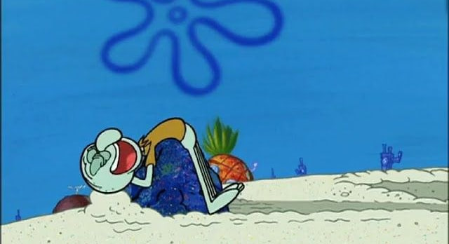

Oktober sudah mau habis. Kata BMKG, musim hujan tahun ini mundur gara-gara El Nino, baru mulai November nanti. Tapi semalam hujan deras sudah datang duluan. Yah namanya juga perkiraan cuaca kan, kadang bisa salah, kadang bisa benar. Mungkin Mba Rara Sang Pawang hujan sudah menggunakan kekuatannya untuk memanggil hujan turun ke Depok. Ya sudahlah, paginya saya mencoba bersyukur, meresapi pelan-pelan. Mungkin karena sudah lama tidak hujan, jadi hujan semalam terasa istimewa.

Tapi saya juga tahu diri. Kalau nanti hujannya keseringan, jemuran tidak kering-kering, jalanan yang sudah macet makin macet, lalu aktivitas mulai terganggu, saya mungkin bakal teriak juga, "Asyu, udan ra rampung-rampung."

Ya begitulah saya. Dikasih hujan minta terang, dikasih terang minta hujan. Dikasih rezeki, masih saja cari celah buat mengeluh. Lihat hidup orang lain kok kayaknya enak terus, padahal ya, urip iku mung sawang sinawang. Selalu ada yang kurang, selalu tidak menghargai pemberian yang maha kuasa.

Sama seperti sebelumnya, hari ini saya ditemani bau brambang goreng, ikan asin, dan sambal terasi. Buat sebagian orang, itu mungkin polusi bau. Buat saya itu anugrah, itu adalah pintu ke mana saja yang baru dibuka oleh Doraemon. Sekali hirup, saya langsung dibawa pulang  ke kampung halaman, padahal badan masih duduk di sini.

Di depan saya ada kopi asem Gayo dan tahu bakso yang siap dimangsa bersama dengan teman sejatinya, lombok rawit. Di telinga ada FitEar mahal, dengan playlist lagu-lagu patah hati. Kombinasinya agak aneh sebenarnya. Mulut menikmati kopi, perut siap diisi tahu bakso, hati malah diajak menderita bareng lagu-lagu untuk orang yang cintanya tidak sampai. Tapi ya sudahlah. Hujan, walaupun sudah reda, dan kopi hitam memang sahabat setia orang patah hati. Hehe.

Sebenarnya saya bingung mau menulis apa. Saya cuma ingin menangkap pagi ini sebelum baunya hilang, kopinya dingin, tahu baksonya tinggal remah, lalu hidup balik seperti biasa dengan segala tetek bengek yang harus diberesin. Bukan dosa, kan, kalau ada satu pagi yang cuma ingin disimpan sebentar?

Lucunya, yang bikin saya merasa pulang ternyata bukan rumah. Cuma bau brambang goreng dan minyak terasi yang nempel di udara. Bahkan lagu patah hati pun entah kenapa malah bikin kangen kampung, padahal hidup saya juga lagi tidak patah-patah amat, hanya berantakan saja.

Hari ini weekend. Saya tidak mau menulis panjang-panjang, apalagi sok menemukan pelajaran hidup dari hujan dan ikan asin. Paragraf soal bersyukur tadi anggap saja khilaf. Saya cuma mau duduk, makan tahu bakso, dengerin musik, lalu bersantai bagaimanpun caranya.

Seperti kata Squidward, 

>"Aku akan bersantai, meskipun itu akan membunuhku."

