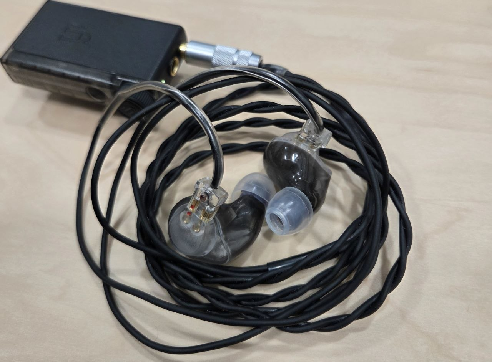

Setelah beli TG334, secara logika harusnya selesai. EXT ada buat critical listening, TG334 buat santai, Mojo 2 dan PB6 juga sudah ada. Mau nyari apa lagi?

Ternyata manusia memang tidak pernah puas.

TG334 dan EXT tidak jelek. Saya saja yang butuh alasan baru buat membeli IEM, jadi saya menjustifikasi ke diri sendiri bahwa saya butuh IEM buat dipakai sehari-hari di kantor. EXT dan TG334 sebenarnya sudah enak, tapi EXT fitting-nya ribet, dan TG334 sayang kalau dibawa ke mana-mana. Masa iya bawa IEM seharga motor bekas ke kantor, ya kan ya?

Sebelumnya posisi ini diisi Vision Ears GO Live!. IEM ini sebenarnya enak, fun, bass-nya mendat-mendut, tapi entah kenapa kalau dipakai lama saya capek sendiri. Entah karena fitting-nya atau gimana, bingung juga saya. Akhirnya, daripada GO Live! cuma jadi pengangguran di rumah, saya mulai cari penggantinya. Syaratnya satu, shell-nya kecil dan nyaman.

Ketemulah FitEar IMarge.

Awalnya saya menganggap IMarge ini semacam FitEar yang "biasa aja". Di atas kertas juga tidak terlalu bikin wow, BA full-range ditambah EST buat bantu treble. Tidak ada 12 driver, tidak ada bone conduction, tidak ada MEMS, tidak ada nama teknologi yang bunyinya seperti senjata pemusnah massal, anjay.

Konsepnya malah agak aneh. BA-nya disuruh main full range, lalu EST cuma "ditambah sedikit" buat membantu bagian atas. Memang begitulah desain IMarge, FitEar memakai BA full-range khusus dari Sonion, lalu EST cuma buat sedikit melengkapi frekuensi tinggi. Kesannya mubazir, tapi ya sudahlah. Dicoba saja.

IMarge dipakai dengan:

- iFi GO blu Air
- FitEar cable 013 (3.5mm stereo mini)
- SpinFit W1 bawaan

### Comfort: Ternyata saya yang bego

Pertama kali pakai IMarge, reaksi saya malah, "Kok begini?" Bass-nya berasa hilang, suaranya tidak seperti yang saya bayangkan. Saya sempat mikir jangan-jangan salah beli lagi. Masa niatnya mengganti GO Live! malah dapat barang begini. Saya memang punya fetish blind buy, cuma ini sudah keterlaluan, masa salah berkali-kali.

Ternyata masalahnya bukan di IMarge. Masalahnya di eartips, lagi.

Entah kenapa penyakit saya kambuh. Sama seperti di TG334, saya tidak langsung percaya sama eartips bawaan. Trauma dari stock tips Vision Ears ternyata membekas cukup dalam di kehidupan saya. Awalnya saya pakai tips lain dulu, karena penyakit sok pintar saya kambuh lagi. Setelah muter-muter, akhirnya saya coba SpinFit W1 yang memang bawaan IMarge.

Anjay, enak, cuy.

Ternyata sebelumnya seal-nya tidak benar. Begitu ukuran W1-nya pas, bass yang tadinya saya kira hilang muncul lagi, vokalnya jadi benar, semuanya mendadak nyambung. Lucunya, FitEar memang sengaja mengecilkan shell dan oval horn stem IMarge dibanding desain universal mereka sebelumnya supaya fitting-nya lebih enak, dan W1 memang eartips yang mereka pilih sebagai bawaan.

Ini kedua kalinya saya kalah sama eartips bawaan FitEar. Kemarin di TG334, SE1000 bawaan ternyata paling enak. Sekarang di IMarge, W1 bawaan ternyata paling enak. Kayaknya ke depan kalau beli FitEar, saya tidak usah sok pintar lagi.

Buat saya, fitting IMarge lebih gampang daripada TG334, dan jauuuuh lebih gampang daripada EXT. Shell-nya relatif compact dan ringan. Tinggal masuk, seal dapat, selesai. Tidak perlu ritual putar kiri, putar kanan, dorong sedikit, lalu berdoa semoga bass-nya keluar.

Ini penting, karena dari awal memang itu tujuan saya beli IMarge, buat dipakai kerja, bukan buat berantem sama lubang kuping.

###  Suara: Kok nggak ada yang menonjol?

Ini mungkin terdengar seperti hinaan, padahal justru ini yang saya suka dari IMarge. Tidak ada bagian yang bikin saya langsung bilang, "Wah anjir, bass-nya mendat-mendut!" Tidak ada juga, "Wah, vokalnya!" kayak di TG334. Apalagi, "Wah gila, treble-nya!" kayak di EXT.

Semuanya ya sudah, dengerin musik. Bass ada. Vokal ada. Treble ada. Terus saya dengerin lagu sampai lupa tadi sebenarnya mau ngecek bagian apa.

Bassnya saat pertama kali dengerin, "Loh, mana jedug-jedugnya?" Kalau datang dari GO Live!, bass IMarge awalnya terasa agak membosankan. GO Live! itu mendat-mendut, ada energi di bawah yang bikin lagu langsung terasa fun. IMarge jauh lebih kalem. Bass-nya ada dan cukup, tapi tidak setiap saat datang mengetuk kepala.

Dulu saya kira ini kelemahan. Lama-lama saya malah curiga, jangan-jangan mid-bass GO Live! itulah salah satu yang bikin saya cepat capek. IMarge lebih rata. Bass gitar masih bisa diikuti, kick masih kerasa, tapi setelah bunyi ya sudah, selesai. Tidak berlama-lama nongkrong di kuping. Jadi kalau nyari bass yang brutal, memang salah alamat.

Buat saya? Justru pas buat kerja, haha.

Mid nya Enak. Vokal IMarge tidak semanis TG334. Kalau TG334 bikin saya senyum-senyum sendiri karena vokalnya tebal dan manieeezz, IMarge buat saya lebih netral. Tapi bukan berarti hambar. Vokalnya tetap maju, berbodi, dan posisinya jelas. Female vocal Jepang juga enak, cuma tidak sengaja didorong ke muka seperti di TG334.

Yang saya suka malah naturalnya. Semuanya tidak dibuat-buat. Mungkin justru karena itu saya bisa lompat dari jejepangan ke slow rock, OST game, lalu lagu galau, tanpa merasa ada yang salah.

Treble nya EST yang tidak "EST banget". Nah, ini lucu. IMarge pakai EST. Kalau cuma baca spek, saya langsung waspada. Telinga saya kan agak kampungan kalau ketemu treble. Terlalu ces-ces sedikit, selesai. RE800 dan JH5 Pro sudah mengajarkan itu.

Tapi EST di IMarge ternyata kalem banget. AIry dan ada ekstensinya, tapi tidak dipamerkan. Simbal tetap keluar cesces, detail  masih ada, tapi tidak ada sensasi treble ditembakkan langsung ke gendang telinga. Kalau treble TG334 halus, IMarge rasanya lebih santai lagi. Kalau yang dicari treble yang bikin "wah", EXT tetap juaranya. 

### Teknikal: Jangan berharap sulap

Soundstage. IMarge terasa cukup open. Tidak gede sampai kepala berubah jadi aula, tapi suaranya juga tidak numpuk di tengah. Vokal tetap punya center yang jelas, sementara musiknya melebar di sekitarnya.

Imaging. Posisi suara gampang diikuti. Tidak sampai bikin saya sibuk menunjuk-nunjuk posisi instrumen, tapi buat musik lebih dari cukup.

Layering. Lagu rame masih bisa diikuti tanpa berubah jadi bubur. Yang saya suka, pemisahannya tidak bikin tiap instrumen terasa dikurung di kamar masing-masing. Semuanya masih terasa jadi satu lagu.

Clarity/detail. Nah, kalau sampeyan cari IEM buat bongkar rekaman sampai kedengeran penyanyinya belum bayar cicilan, mungkin bukan ini. Detailnya ada, tapi IMarge tidak menyodorkan detail ke muka.

Dan saya malah tidak terlalu peduli. Saya beli ini buat dengerin musik, bukan buat kerja lagi setelah pulang kerja.

###  Fatigue: Oh, ternyata ini gunanya IMarge

Nah. Ini alasan saya beli IMarge. GO Live! sebenarnya enak, bahkan fun banget. Masalahnya, setelah dipakai sekian lama, saya capek. Entah karena mid-bass-nya yang terlalu aktif, fitting-nya, atau kombinasi keduanya. EXT dan TG334 tidak bikin capek, tapi bukan barang yang pengen saya bawa ke kantor. IMarge mengisi lubang itu. Bass tidak mendat-mendut terus. Treble tidak nusuk. Vokal tidak teriak. Suaranya juga tidak terlalu sibuk pamer detail. Tinggal colok, putar musik, kerja. Ya ini memang pembelaan saya agar bisa beli earphone baru.

Satu jam. Dua jam. Lalu lupa kalau lagi pakai IEM. Rasanya sama seperti dulu waktu pakai Phonak PFE, walaupun tetap tidak senyaman Phonak yang beneran hilang di kuping.

Lucunya, "lupa waktu waktu mendengarkan" memang salah satu tujuan desain IMarge dari awal. FitEar bilang mereka mengejar suara yang natural dan bikin hanyut sampai pendengar lupa waktu. Kalau begitu, mereka berhasil. Setidaknya di kuping saya.

###   Kesimpulan?

Aneh. Kalau dibandingin sama harganya, IMarge ini biasa. Tidak ada yang bikin bengong, tidak ada yang bikin senyum-senyum kayak TG334, tidak ada yang bikin "wah" kayak EXT. Tapi saya suka. Mungkin dari biasa jadi luar biasa. Atau mungkin karena saya orangnya biasa aja, jadi cocoknya sama yang biasa juga. Embuhlah.

Kalau disuruh pilih IEM yang suaranya paling bikin kagum, IMarge bukan pemenangnya. Tapi kalau besok pagi harus ke kantor dan cuma boleh bawa satu IEM sampai sore?

IMarge lah juaranya.

Lucu juga. Beli barang mahal-mahal, ujung-ujungnya yang paling sering dipakai malah yang bikin saya paling jarang mikirin suara. Colok, musik nyala, kerja, lupa. Mungkin saya sudah sampai di tahap hobi audio di mana barang bagus itu barang yang bikin saya berhenti mikirin hobi audio.

Dompet tetap berduka, seperti biasa. 

Selamat pensiun, GO Live!. Kamu enak, tapi kuping saya bukan buat kamu.
