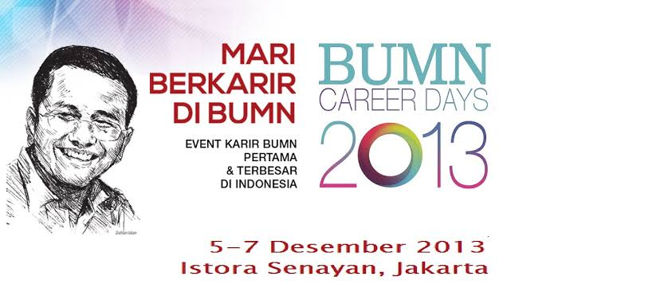

Sebelum kerja di Jakarta, saya sudah punya kenangan di kota ini. Atau lebih tepatnya, di kecamatan ini.

Dulu, tidak lama setelah lulus kuliah, ada event besar yang ditunggu-tunggu para pencari kerja. Saya masih ingat namanya karena event ini benar-benar membawa mimpi buat anak-anak pencari kerja macam saya. Di posternya ada foto Pak Dahlan Iskan, ✨ criiing. Namanya BUMN Career Days, 5–7 Desember 2013, di Istora Senayan, Jakarta.

Saya sebenarnya tidak terlalu menggebu-gebu ingin datang, namun ada teman yang mengajak dan mau berangkat bareng dan akhirnya saya mengiyakan. Namanya Ucup. Buat saya yang tidak pernah keluar kota, yang paling jauh cuma ke rumah simbah di desa sebelah, ini jelas tantangan. Ke sana naik apa, nanti tinggal di mana, saya tidak tahu. Jadi semuanya saya gantungkan ke Ucup. Pejah gesang saya ikut Ucup. Mau dibawa ke mana pun, saya ikut beliau.

Untungnya dapat juga tempat tinggal, numpang di rumah mbah-nya teman SMA Ucup, di Jalan Zeni, Mampang. Ini angin segar. Tidak perlu cari penginapan, berarti hemat, dan buat mahasiswa baru lulus yang belum punya penghasilan, hemat itu penting sekali.

Saya berangkat naik kereta ekonomi PSO, yang paling murah. Kereta apa persisnya saya sudah lupa. Yang saya ingat, itu pertama kalinya saya naik kereta jarak jauh. Ya memang saya bukan orang yang suka ke mana-mana.

Dari stasiun, kalau tidak salah, kami naik busway ke Mampang. Iya betul, saya menyebutnya busway. Dulu orang lebih sering menyebutnya begitu ketimbang TransJakarta. Sepanjang jalan saya melongo seperti anak kecil yang baru lihat hal baru. Oh, begini toh Jakarta. Gedung tinggi di mana-mana, lalu lintasnya gila, semua orang kelihatan terburu-buru. Saya, si katak dalam tempurung dan introvert ini akhirnya lihat dunia luar juga. Itu juga pertama kalinya saya lihat langit Jakarta, yang sampai sekarang saya tidak yakin itu mendung beneran atau polusi. Beda jauh sama kampung saya.

Sampai di rumah mbah nya temen Ucup, saya bebersih, bongkar tas, lalu siap-siap buat besok. Di sini saya pertama kali makan di warkop tek-tek abang-abang Jakarta. Rasanya enak. Entah memang enak, entah karena akhirnya bisa makan di warkop kayak yang di tipi-tipi, atau karena saya memang kelaparan setelah perjalanan panjang. Nasi goreng tek-tek pun kayaknya pertama kali saya makan waktu di sini, haha.

Hari-H, saya ke Istora naik busway lagi. Niat saya sudah bulat, daftar sebagai IT Engineer. Si Konservatif kolot ini memang bercita-cita jadi Security Engineer, atau paling tidak IT Engineer, padahal dia tahu betul dirinya lulusan Teknik Fisika. Ada dua perusahaan yang saya lamar waktu itu, ICON+ dan INTI. Kalian pasti bisa tebak hasilnya, seleksi berkas pun tidak lolos. Ya wajar, beda jurusan.

Terus, apa semua itu sia-sia? Ya enggak. Setidaknya saya jadi punya pengalaman baru. Ucup sendiri daftar ke perusahaan apa saja, saya sudah lupa. Yang saya ingat, selama di sini kami bertiga (saya, Ucup, dan temen Ucup) sempat nonton pentas seni, semacam konser. Konser apa, saya juga lupa. Waktu itu saya paling anti mendokumentasikan apa pun, dan sekarang itu jadi salah satu penyesalan saya.

Pas hari pulang, saya naik busway Koridor 6, lanjut ke arah Senen. Saya ingat bus berhenti di lampu merah pertigaan Mampang, yang arah Kuningan dan Tendean. Di situ benar-benar ruwet. Saya sampai bengong, dan pemandangan itu masih membekas sampai sekarang. Motor dan mobil numpuk jadi satu, isinya wajah-wajah pencari nafkah. Saya langsung menjulukinya Gates of Hell, diambil dari jurus Sura di Ragnarok Online, game yang waktu itu lagi sering saya mainkan. Biar kedengaran keren aja sih. Tapi ruwetnya memang pantas dapat nama itu.

Dalam hati saya bilang, "Semoga saya nggak akan tinggal atau kena macet di sini."

*****

_Sore hari, 3 November 2026 jam pulang kerja_

Saya menulis draft kasar ini di pertigaan Tendean arah Mampang, di atas Vario butut saya, sambil kejebak macet.

Iya, kalian tidak salah baca. Di Gates of Hell itu. Bayangkan, saya bisa sampai mengeluarkan HP sebentar untuk menulis draft kasar yang tiba-tiba terlintas di pikiran di saved messages Telegram.

Doa saya dulu ternyata tidak terkabul. Dari pertama kerja, saya malah sudah tinggal di Mampang. Pindah kerja, pindah rumah, jalan pulang saya tetap lewat Mampang, lewat jalan yang paling tidak ingin saya lewati.

Kalau Cakil kecil lihat ini, mungkin dia ketawa mencibir. Atau malah bangga, karena dirinya yang dewasa ternyata bisa bertahan sejauh ini, dua belas tahun sejak doa itu. Saya tidak mau menghakimi. Saya memang pesimis, tapi saya percaya semua ada alasannya. "Everything happens for a reason." Kedengarannya memang kayak coping mechanism wong kalahan, tapi tidak apa-apa, asal bisa bikin saya tenang, hal itu tidak masalah.

Mungkin benar kata orang bijak, jangan terlalu benci sama sesuatu, nanti kamu malah jadi mencintainya. Dadadam, dadadah - dadadam dadadah.

I love you, Mampang. Semoga kita bisa menjalin hubungan baik sampai saya balik ke Jogja, wakakaka.
