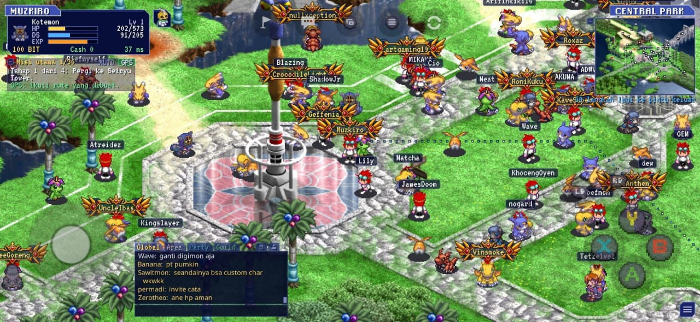
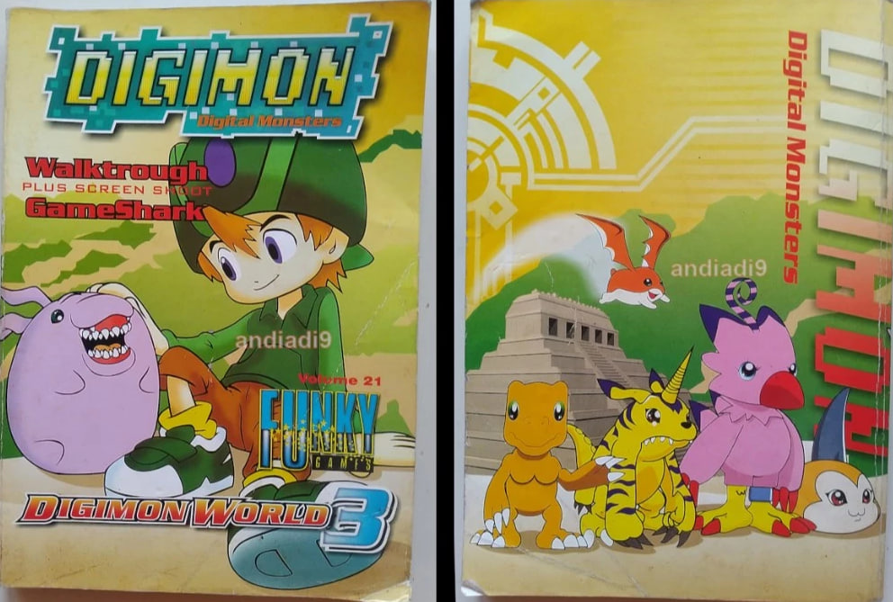

Beberapa hari ini berseliweran di beranda facebook, kabar soal salah satu game masa kecil saya yang dimod jadi online, Digimon World 3. Sekarang katanya bisa dimainkan bareng teman-teman secara online.

Game ini favorit saya waktu kecil. Padahal pertama kali beli di PS, saya beneran tidak bisa memainkannya. Tidak tahu harus ke mana, harus ngomong ke siapa, harus ngapain. Beda dengan Final Fantasy yang masih bisa dimainkan pakai insting, Digimon World 3 memang terkenal sulit. Rasanya mustahil menamatkannya tanpa walkthrough, sementara di tempat saya waktu itu internet belum masuk. Agak ketinggalan memang. Akhirnya CD-nya teronggok di pojokan, bergabung dengan game-game lain yang dibeli tapi tidak pernah dimainkan. 

Beberapa bulan kemudian, saya lupa tepatnya kapan, yang jelas bulan puasa, saya diajak ke Gramedia. Dulu saya memang dijatah sebulan sekali beli komik atau bacaan lain di sana, jadi acara ke Gramedia itu lumayan sakral bagi saya. Waktu keliling, di rak bagian game, saya menemukan buku walkthrough Digimon World 3.

Anjay.

Saya buru-buru mengambil buku itu, lalu kaget lihat harganya. Bukunya tebal, setebal kekesalan saya ke game yang memang kek anjing itu. Jadi harganya pun pasti ikut mahal mengikuti jumlah halaman buku. Saya sempat ragu, tapi akhirnya membulatkan tekad. Dengan tidak tahu diri, saya datangi bapak saya dan bilang mau beli buku seharga segitu. Bapak saya mengizinkan. Buku untuk game laknat setebal 224 halaman itu resmi jadi milik saya. Bahagialah saya. Akhirnya bisa tamat juga, pikir saya.

Untung tak dapat diraih, malang tak dapat ditolak. Eh, bukan, bukan. Bukunya bukan jelek. Masalahnya, sudah pakai walkthrough pun, game ini tetap game laknat. Bayangkan, pemain sering dipaksa jadi kurir. Jalan jauh cuma buat mengantar satu barang, bolak-balik cuma buat ketemu satu NPC, lalu NPC lainnya. Kira-kira seperti dari Depok ke Jakarta Utara, balik lagi ke Depok, hanya untuk ketemu satu orang. Bajingan, batin saya. Belum lagi grinding-nya. Naik level saja beratnya minta ampun. Apalagi saya memilih Maniac Pack, isinya Guilmon, Bearmon, dan Patamon. Digimon-digimon bangsat yang di awal susahnya setengah mati buat naik level.

Tapi dari semua itu, ada satu yang paling saya benci, Mobius Desert. Saya masih ingat betul walaupun waktu itu masih bocah. Padang pasir ini didesain looping, dan game-nya sama sekali tidak kasih petunjuk jalan atau hint. Pemain dipaksa trial and error. Dan kamu tahu? Walkthrough yang saya beli pakai uang bapak saya itu juga tidak menjelaskan sama sekali cara melewatinya, asu. Sekarang, setelah dewasa, mengingatnya saja saya masih kesal.

Anehnya, waktu itu saya senang-senang saja. Mungkin karena masih kecil. Mungkin juga karena bulan puasa, jadi waktunya pas, game yang benar-benar menghabiskan waktu, ketemu puasa yang kerjaannya memang menunggu buka. Siang yang panjang habis buat jalan bolak-balik, kesasar, grinding, kesasar lagi.

Dan ya, saya akhirnya berhasil mencapai Mega untuk dua digimon. Guilmon jadi Gallantmon, Bearmon jadi Marsmon. Patamon sudah saya lupakan. Mega-nya terlalu susah didapat, jadi saya anggap dia tidak pernah ada. Setelah tamat melawan Galacticmon, saya beneran bangga. Merasa keren banget bisa namatin game yang questnya beneran ekstrim ini. Tapi teman saya lebih gila lagi. Setelah dapat walkthrough-nya, plus entah dapat info dari mana, dia berhasil dapat Veemon dan mengevolusikannya sampai Imperialdramon Paladin Mode. 

Terus, apakah saya bakal install lagi versi online-nya?

Tentu tidak. Saya tahu tidak akan merasakan hal yang sama seperti waktu kecil, perasaan senang yang bikin deg-degan itu, perasaan emosi waktu bolak-balik, dan grinding yang menyebalkan itu. Lagi pula, saya juga malas. Mau main sama siapa memangnya? Saya bukan tipe yang penasaran sama gameplay online atau fitur-fitur barunya. 

Lucu juga sebenarnya. Game yang bikin saya emosi hampir tiap hari, kok bisa saya sebut favorit? Orang Jawa bilang, witing tresno jalaran soko kulino. Cinta tumbuh karena terbiasa. Mungkin itu yang terjadi sama Digimon World 3. Game-nya jelas tidak ramah bagi perasaan saya yang sensitif. Tapi sebulan penuh, tiap siang sambil menunggu buka, saya bolak-balik nemuin NPC, grinding, dan kesasar di tempat yang sama.

Witing tresno jalaran soko kesasar nang Mobius Dessert, jingan.
